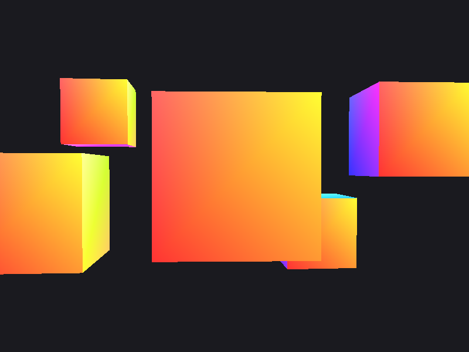
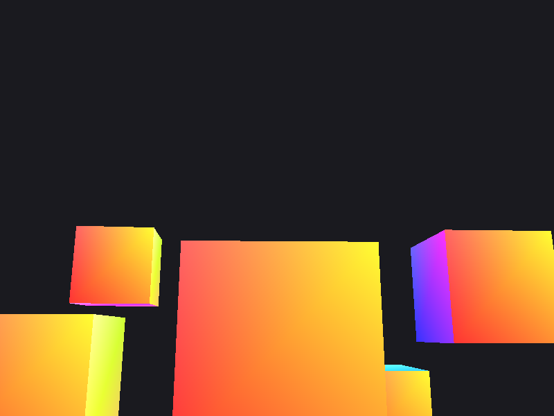
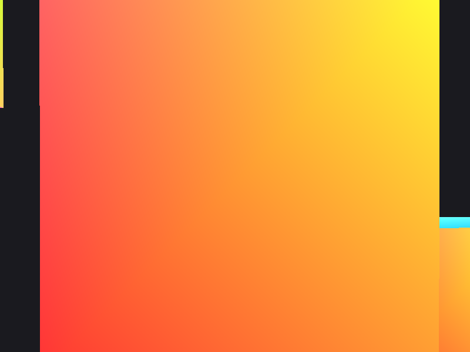
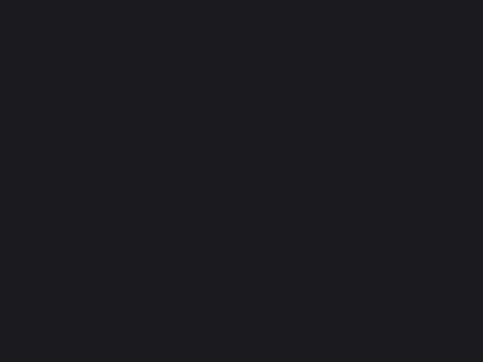
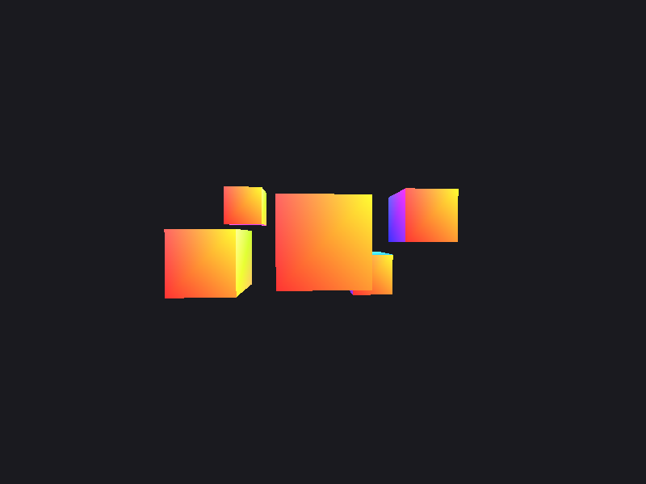

# 10-апта: толық еркін камера (тінтуір + дөңгелек)

C++17 · OpenGL 3.3 Core · GLFW · GLEW · GLM · CMake (Ubuntu / WSL)

```bash
sudo apt install build-essential cmake libglfw3-dev libglew-dev libglm-dev
cmake -S . -B build && cmake --build build
./build/cg
```

Басқару: `W A S D` жылжу, `Space`/`Left Shift` жоғары/төмен, `Left Ctrl` жүгіру,
тінтуір — бұрылу, дөңгелек — zoom, `I` — invert Y, `P` — камера күйін шығару,
`R` — бастапқы күй, `Esc` — шығу.

## Негізгі бөлім

- `yaw = -90`, `pitch = 0` — камера бастапқыда кубқа қарайды (`yaw = 0` болса +X-ке қарап, куб көрінбейді).
- `GLFW_CURSOR_DISABLED` + `mouse_callback` + `scroll_callback`.
- `yoffset = lastY - ypos` (экранның y-і төмен өседі), `glm::radians` қолданылған, `pitch` ±89°-пен шектелген.
- `firstMouse` — алғашқы оқиғада камера лақтырылмайды.
- `projection` ішінде `glm::radians(fov)` — дөңгелек шынымен әсер етеді.

| 01-default | 02-looking-up | 03-zoomed (fov = 20) |
|---|---|---|
|  |  |  |

## Таңдалған sensitivity

**`sensitivity = 0.1`.** Бір толық айналымға 360 / 0.1 = 3600 пиксель керек (0.03 болса
12000 px — тінтуірді тым көп көтеріп қою керек, 0.5 болса 720 px — камера тым
өткір, дәл бағыттау қиын), сондықтан 0.1 — дәлдік пен жылдамдықтың орта мәні.

**Қорғау сұрағы.** `sensitivity` `const`, себебі ол бағдарлама жұмысында өзгермейтін
баптау, кездейсоқ өзгертіп алмау үшін. Оны жаһандық айнымалы етіп, пернемен (мысалы `+`/`-`)
өзгертуге **болады** — тек `const` алынып, күйді сақтау керек (перне оқиғасы да `I`-дегідей).

## 1-тапсырма. Pitch шектеуінсіз

`--no-pitch-clamp` флагымен екі шектеу жолы өшіріледі. Тінтуірді жоғары апарғанда
**pitch = 90°**-та көрініс бұзылады (`04-broken.png`: экран бос, тек фон түсі).



Тізбек:
1. `pitch = 90°` ⇒ `cos(radians(90°))` теориялық **0**, сондықтан `dir.x = cos(yaw)·cos(pitch) = 0`, `dir.z = sin(yaw)·cos(pitch) = 0`.
2. `camFront = normalize(0, 1, 0)` — камера тура жоғарыға қарайды, яғни `camUp = (0,1,0)`-мен **параллель**.
3. `lookAt` ішінде оң вектор `cross(camFront, camUp)` = **(0, 0, 0)** — параллель векторлардың көбейтіндісі нөл.
4. `normalize((0,0,0))` = 0/0 ⇒ **NaN**. `view` матрицасы NaN-ға толады, барлық вершиналар NaN болады, ештеңе сызылмайды — тек `glClearColor` қалады.

Нақты бақылау (`float`): `cos(radians(90.0f))` = `-4.37e-8`, нөл емес. Сондықтан
`camPos = (0,0,3)` кезінде көрініс **әлі NaN емес**: `camFront` өте кішкентай, бірақ
нөл емес (`view has NaN: no`), камера жай аспанға қарайды. Бірақ `camPos.x ≠ 0` болғанда
(мысалы, алдымен `D` бассаңыз) `camPos + camFront` қосындысында `4e-8` жоғалады,
`camFront` нақты `(0,1,0)` болады және `view has NaN: yes` — скриншот осы жағдайда
түсірілген. `pitch > 90°` болса (`cos < 0`) NaN болмайды, бірақ камера «аударылып»
кетеді (yaw-дың бағыты қарама-қарсы болады). Шектеу ±89° қайтарылған.

## 3, 4-тапсырмалар

- **Invert Y (`I`).** Алдыңғы күйді (`iPressedLast`) сақтамасақ, перне басулы тұрғанда
  `invertY` әр кадрда (60 рет/с) ауысып отырады, нәтиже кездейсоқ. WASD-та бұл
  мәселе жоқ: ол «басулы тұр ма» деген сұрақ, әр кадрда қозғалу керек, ал `I` — бір
  басуда бір рет ауысатын **күй**.
- **P — күй.** `camPos`, `camFront`, `yaw`, `pitch`, `fov`, `length` шығады. Тексеру:
  `length` = `1.0000001` / `1.0000000` — дәл 1.0 емес, `float` дөңгелектеу қатесінің
  әсері (математикада `cos²p(cos²y+sin²y)+sin²p = 1`, бірақ `float`-та ~1e-7 қате жиналады).
  `normalize`-ды алып тастасақ, ұзындық математикалық түрде бәрібір ≈1 болар еді
  (формула өзі бірлік вектор береді), бірақ қате жинақталып, кепілдік жоқ; `normalize` кепілдік береді,
  әсіресе `lookAt` және `cross` үшін.

## 5-тапсырма. fov шегі 45 → 90



Дөңгелекті артқа айналдырып fov = 90°-қа жеткізгенде кубтар кішірейіп, сахна кеңейеді,
ал шеттегі кубтар созылып көрінеді.

**Қорғау сұрағы.** Бұл қате емес, перспективалық проекцияның қалыпты қасиеті.
Проекция матрицасы `1/tan(fov/2)` арқылы масштабтайды: fov үлкейген сайын көру
конусы кең, экран жазықтығына проекцияланған бұрышы үлкен (шетте) объектілер
экранда үлкен көлденең созылым алады (шамамен `1/cos²θ`). Көру бұрышы 90°-қа
жуықтағанда бұл анық байқалады; қалыпты экран/көру қашықтығы үшін fov 45–60° жақсырақ.

## Орындалған қосымша тапсырмалар

- **Қ2.** Терезе тақырыбында `yaw`, `pitch`, `fov` көрсетіледі.
- **Қ3.** `R` — `camPos`, `yaw`, `pitch`, `fov` бастапқы мәндеріне қайтады.
- **Қ4.** `yaw` ±360°-тан асқанда шегеріледі (`--mouse 5000,0` → `yaw = 50.0`, шексіз өспейді).
- **Қ1** (Shift-пен жүгіру) орындалмады: `Left Shift` 9-аптадан бері «төмен» жылжытады, жүгіру `Left Ctrl`-ге қойылған.

## Тексеру флагтары

Тінтуір мен дөңгелекті терминалдан имитациялау үшін: `--mouse dx,dy`, `--scroll n`,
`--no-pitch-clamp`, `--hold W,D`, `--invert`, `--fixed-dt s`, `--shot f.ppm`
(скриншоттар осылай түсірілген; `tools/ppm2png.py` PPM → PNG).
